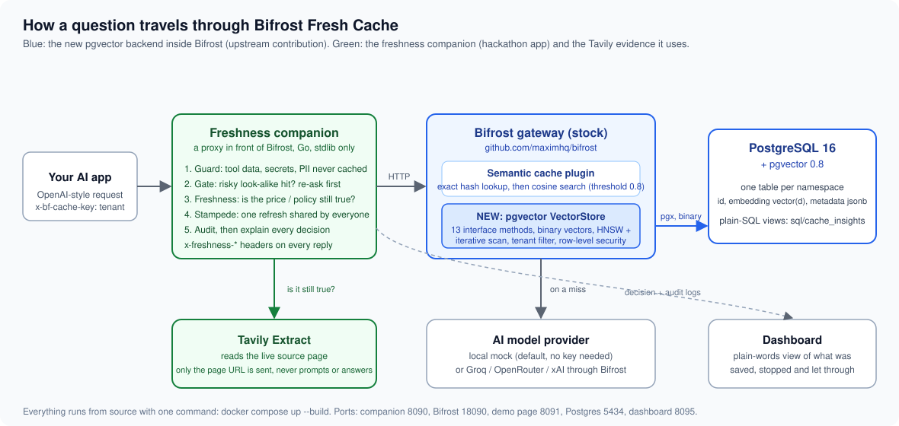
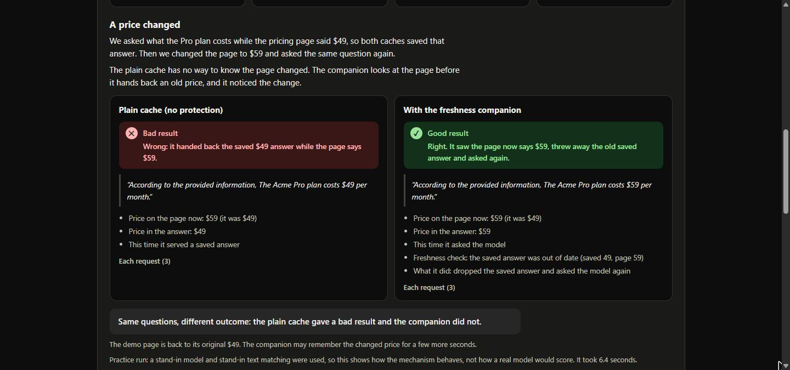
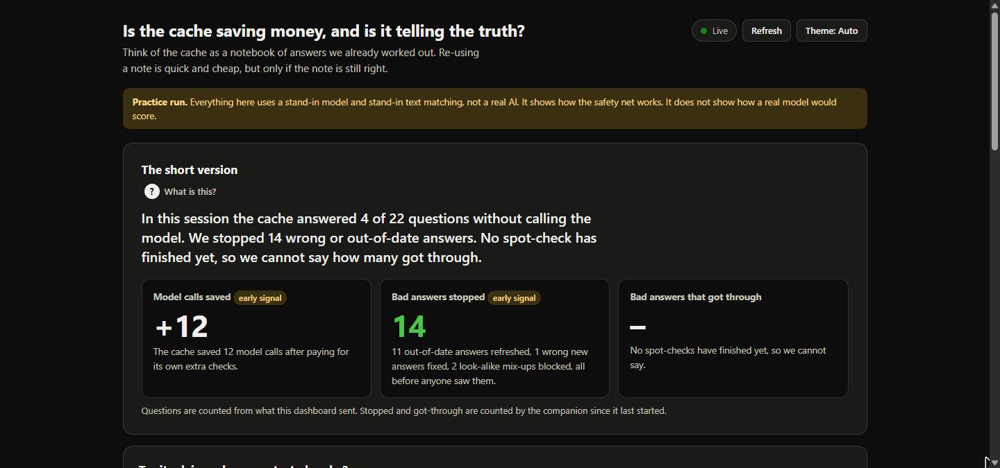

# Bifrost Fresh Cache

**A Postgres/pgvector backend for Bifrost's semantic cache, and a small companion that stops the cache from lying to you.**

Built for the Geek Room Global AI Hackathon 2026, Track A, Problem 04: *build the missing open-source gateway feature*. It uses [Bifrost](https://github.com/maximhq/bifrost) as the gateway we extend, and [Tavily](https://tavily.com) as the eyes that check whether a cached answer is still true.



---

## The itch we scratched

A semantic cache is a great idea with a quiet failure mode. It remembers answers and hands one back whenever a new question *looks like* an old one. That saves model calls and latency. It also keeps saying "$49" long after the pricing page moved to $59, confuses "reset my username" with "reset my password", and happily reports a rising hit rate while it does so. Every one of those replies comes back `200 OK`. Nobody notices until a customer does.

We hit two versions of this problem while reading Bifrost's code and issue tracker:

1. **You couldn't put the cache in Postgres.** Bifrost's semantic cache could talk to Chromem, Pinecone, Qdrant, Redis and Weaviate, but not PostgreSQL, even though pgvector is sitting in most teams' databases already. Running one more database just for a cache is a real operator cost. ([maximhq/bifrost#3180](https://github.com/maximhq/bifrost/issues/3180), open since May 2026.)
2. **Nothing checked whether a cached answer was still right.** A TTL is a guess. The source changes when it changes.

So we built both halves.

## What's in the box

| Part | What it does | Where |
|---|---|---|
| **pgvector VectorStore** for Bifrost | A full `VectorStore` implementation (all 13 methods), config and Helm wiring, docs, and 32 tests that run against a real PostgreSQL. Written to be a PR, not a hack. | [`bifrost/`](bifrost) fork, branch `feat/pgvector-vectorstore`, mainly `framework/vectorstore/pgvector.go` |
| **Freshness companion** | A reverse proxy in front of Bifrost. Before it reuses a time-sensitive answer, it reads the live source (through Tavily Extract) and compares. It also gates risky look-alike hits, keeps tool results and secrets out of the cache, shares one refresh across a stampede, audits a sample of reuses, and explains every decision. Go, standard library only. | [`freshness-companion/`](freshness-companion) |
| **Postgres-only extras** | Row-level security as a second tenant wall enforced by the database, cleanup of expired rows (they otherwise live forever), `halfvec` compact vectors (about half the disk in our test), and plain SQL views over the cache. | `bifrost/` docs, [`sql/`](sql) |
| **Dashboard** | Answers "is the cache saving money, and is it telling the truth?" in plain words, with a Try-it panel that runs the same scenario through a plain cache and through ours, side by side. | [`dashboard/`](dashboard) |
| **Evidence** | Store benchmarks against Qdrant, a threshold-quality harness, an impact benchmark, and a 16-step end-to-end run through the real gateway. | [`eval-harness/`](eval-harness), [`e2e/`](e2e) |

## See it fail, then see it not fail

The dashboard runs the same question through two caches. Left: Bifrost's cache on its own. Right: the same cache with the companion in front. We changed the price on the demo page between the two asks.



And the summary after running all four scenarios (a price change, two look-alike questions, an answer built on live tool data, and a burst of ten people asking at once):



The yellow banner is deliberate. Those numbers come from a mock model and mock embeddings, so they show how the safety net behaves, not how a real model would score.

## Measured impact

Same scripted workload, same Bifrost, three setups. `plain` is Bifrost with its defaults (threshold 0.8, 30-minute TTL). `companion` adds our proxy. `plain-ttl` is the usual workaround, a 5-second TTL. Median of 3 runs, 56 requests per setup per run. Full report: [`eval-harness/results/impactbench-20261105-123632.md`](eval-harness/results/impactbench-20261105-123632.md).

| | plain | **companion** | plain-ttl |
|---|---:|---:|---:|
| Stale answers served (old price) | 28 | **0** | 0 |
| Wrong-match answers served | 4 | **2** | 5 |
| **Bad answers per 1,000 requests** | 571 | **36** | 89 |
| 16 simultaneous asks at a stale entry: stale answers / model calls | 16 / 0 | **0 / 1** | 0 / 16 |
| Answers reused although the request carried live tool data (of 4) | 2 | **0** | 2 |
| Cache hit rate | 78.6% | 37.5% | 33.9% |
| Model calls | 12 | 32 | 37 |
| Latency p50 | 3.6 ms | 106 ms | 104 ms |

The honest reading: the companion removes every stale answer and most wrong matches, and it survives a burst with one model call instead of sixteen. It is not free. It makes more model calls and answers more slowly than a plain cache that is happy to be wrong, because every refresh is a real call the plain cache skipped. Against the short-TTL workaround it wins on all three counts: fewer bad answers, a slightly higher hit rate, fewer model calls. The two wrong matches it still lets through are a "two-factor on / two-factor off" pair that the mock embedding scores at similarity 1.0, which no threshold can separate; the background audit flags them afterwards.

## Run it

You need Docker Desktop (or Docker Engine with Compose v2) and Git. No API keys. The default stack uses a local stand-in model so anyone can run it.

```bash
git clone --recurse-submodules https://github.com/MadhusudhanM23/bifrost-fresh-cache.git
cd bifrost-fresh-cache
docker compose up --build --wait
```

The first build takes a few minutes (it compiles Bifrost from the fork). Then:

| What | Where |
|---|---|
| Freshness companion (send your requests here) | http://127.0.0.1:8090 |
| Bifrost gateway, stock, with the pgvector store | http://127.0.0.1:18090 |
| Demo pricing page the companion watches | http://127.0.0.1:8091 |
| PostgreSQL 16 + pgvector 0.8 | `127.0.0.1:5434`, user `bifrost`, password `bifrost_password` |

Ask the price question twice and watch the headers go from a miss to a confirmed hit (`x-bifrost-cache-hit`, `x-freshness-status`):

```bash
curl -s -D - http://127.0.0.1:8090/v1/chat/completions \
  -H "Content-Type: application/json" -H "x-bf-cache-key: demo" \
  --data-binary "@docker/request-49.json"
```

Now open `freshness-companion/demo-page/index.html`, change `$49` to `$59`, and send the same request a third time. The companion reads the page, sees the cached answer is out of date, drops it and asks the model again: `x-freshness-status: stale`. [DOCKER.md](DOCKER.md) walks through this and the other demos step by step, including the look-alike, tool-data and stampede cases. (On Windows use `curl.exe`.)

**Dashboard** (needs Go):

```bash
cd dashboard
go run . -demo-page ../freshness-companion/demo-page/index.html
# open http://127.0.0.1:8095
```

**Smoke test** of the running stack (18 checks): `powershell -File smoke.ps1`. **SQL views** test (45 checks): `powershell -File sql/test.ps1`. Bash versions of the SQL scripts are in `sql/` too.

### With a real model

Put a key in `.env` (copy `.env.example`; Groq, OpenRouter and xAI are wired) and start with the overlay:

```bash
docker compose -f docker-compose.yml -f docker-compose.real.yml up -d
powershell -File real-model-check.ps1
```

Embeddings still come from the local mock in this mode. See the "Real model" section of [DOCKER.md](DOCKER.md).

### With Tavily

The default compose stack reads the demo page directly, because Tavily cannot reach a page that only exists on your machine. To use Tavily for real: put `TAVILY_API_KEY` in `.env`, host `demo-page/index.html` somewhere public (GitHub Pages is enough), point `docker/policy.json` at that URL, and switch the companion flag to `-provider=tavily_extract`. The companion's Tavily code is exercised by `freshness-companion/cmd/tavilycheck`, which reads one public page through the exact same client.

## How the two technologies are used

**Bifrost** is the thing we extend, not just a thing we call. The pgvector store plugs into Bifrost's `VectorStore` interface, registers through its config schema and Helm chart, and is covered by Bifrost's own shared contract tests plus our own. The companion sits in front of a *stock* Bifrost build and drives it through its public API: `x-bf-cache-key` for tenant buckets, `x-bf-cache-no-store` to keep things out, `DELETE /api/cache/clear/{id}` to evict a stale entry. Nothing in the companion depends on a private hook.

**Tavily** is the companion's evidence. When a cached answer is about a watched fact (a price, a policy, an opening time), the companion asks Tavily Extract for the current page, pulls the value with a configured pattern, and compares it with the value in the cached answer. Only the source URL ever goes to Tavily; prompts, answers and credentials never leave the box. If Tavily is unreachable the response says so in a header (`unable_to_verify`) instead of pretending.

## How the pgvector backend works

```
app  →  Bifrost  →  semantic-cache plugin  →  VectorStore interface  →  pgvector store  →  PostgreSQL + pgvector
```

- **One table per namespace**: `id TEXT PRIMARY KEY, embedding vector(dim) NULL, metadata JSONB`. A table comment marks what the store owns; it never adopts or drops a table it did not create.
- **Cosine exactly as Bifrost defines it.** pgvector's `<=>` returns distance, so we report `1 - distance` and apply the threshold as `distance <= 1 - threshold`. Tests check scores against vectors built at known cosines.
- **Indexes**: GIN on the metadata for the cache's equality filters; HNSW (`vector_cosine_ops`) for similarity up to pgvector's 2,000-dimension limit, exact search with a warning above it.
- **No false misses on filtered search.** With 10,000 entries under *another* cache key sitting nearer the query, a default HNSW scan returned 0 rows although 10,000 qualified. We turn on `hnsw.iterative_scan` (pgvector 0.8+) once per connection and have a regression test for it.
- **Binary vectors over pgx**: about 6 KB instead of 17 KB on the wire for a 1,536-dimension vector, and encoding drops from roughly 115 µs with 55 KB of allocations to about 1.3 µs with none. The text path stays as a tested fallback.
- **Safety**: every filter value and field name is a bind parameter; namespace and schema names are validated and quoted; start-up across replicas is serialised with an advisory lock; a database error is never turned into a cache hit; the password never appears in logs or errors (tested).
- **Metadata-only rows**: the embedding column is nullable, so direct-hash entries need no placeholder vector.

32 pgvector tests plus Bifrost's shared contract tests pass against PostgreSQL 16.15 / pgvector 0.8.7 (`go test ./vectorstore/ -run PgVector -count=1` in `bifrost/framework`). `go build`, `go vet` and `gofmt` are clean.

## What the companion checks, in order

1. **Guard.** Requests that carry a tool result, offer an action tool, or contain an email, card number, token or similar never touch the cache.
2. **Verified answers.** A small human-approved table, matched on exact wording, served first and still checked against the live source when the topic is watched.
3. **Gate.** A semantic hit in the risky band just above the threshold (below 0.90 in the demo) is re-asked *before* it is served; a wrong one is replaced and the right answer cached for that exact question.
4. **Freshness.** For a time-sensitive hit, read the live source, compare, and on a mismatch clear and re-ask. Outcomes: `confirmed`, `stale`, `unable_to_verify`, `unknown`.
5. **Wrong from the start.** A fresh answer whose number disagrees with the verified source is reported, removed or re-asked.
6. **Change notices.** `POST /freshness/changes` marks entries for re-check on their next hit.
7. **Stampede.** Everyone waiting on the same refresh shares one model call.
8. **Audit.** A sample of reuses is re-asked afterwards and turned into a wrong-match rate and a suggested threshold.
9. **Explain.** `GET /freshness/explain/{id}` says in plain words how a request was answered, without the prompt or answer text.

Every response carries `x-freshness-*` headers with the outcome. Details, flags and the test list are in [freshness-companion/README.md](freshness-companion/README.md). `go test ./...` there runs 183 tests counting subtests.

## Proof it works end to end

[`e2e/`](e2e) builds `bifrost-http` from the fork, points it at Postgres and a local mock OpenAI server, and walks 16 steps: miss, direct hit, semantic hit at 0.878, tenant isolation, eviction, TTL expiry, streaming replay, and a **gateway restart after which cached entries are still served** because they live in Postgres. The recorded run is [`e2e/e2e-run.log`](e2e/e2e-run.log) (re-run 10 Nov 2026, 16/16).

## Where things are

```
bifrost/              Bifrost fork (git submodule) with the pgvector store, branch feat/pgvector-vectorstore
freshness-companion/  the proxy, its tests, demo page, Tavily client
dashboard/            Go server + single HTML page
eval-harness/         storebench, cachequality, hybridspike, impactbench + results/
e2e/                  end-to-end harness and the recorded run
sql/                  cache_insights views, install/load/test scripts
tools/mock-openai/    deterministic stand-in model and embeddings
docker/               compose configs, Dockerfiles, demo policy
DOCKER.md             the walkthrough judges should follow
```

## Honest limits

- Every benchmark number here uses a mock model and mock embeddings. They show the mechanics and the trade-off, not real-model quality or a savings forecast.
- Tavily is proven live on single page reads; the full price-change demo through Tavily needs the demo page hosted publicly.
- The audit's default comparison is exact text. With a real model (Groq, 10 Nov) that flagged 2 of 2 correct paraphrase reuses as wrong, because real models word things differently each time. A `judge` mode, where a model decides if two answers agree, got both test cases right. Two cases is a test, not a validation.
- The gate covers hits below its line and fails open if it cannot run. Exact-hash hits on a pre-planted answer in a shared bucket are not gated.
- Row-level security guards against bugs and forgotten filters, not against someone holding the app role's password.
- The companion keeps its state in one process. Two copies would not share it. The store is benchmarked (10,000 rows, 8 clients); the whole gateway plus companion is not load-tested.
- Latency measured from a Windows host through Docker Desktop is dominated by Docker's port proxy (60 ms vs about 8 ms inside the network). Representative numbers in `eval-harness/` come from a Linux client on the Docker network.
- We measured a keyword-plus-meaning hybrid search and chose not to build it; the mock embeddings flatter it and it would cost privacy. See `eval-harness/results/hybridspike-recommendation.md`.

## Technologies

Go 1.27 · PostgreSQL 16 · pgvector 0.8 (`pgx` driver, binary protocol) · Bifrost (Go AI gateway) · Tavily Extract API · Docker Compose · plain HTML/JS for the dashboard and demo page · PowerShell and Bash for the scripts.

## Team and tools

Built solo by **Madhusudhan M** ([MadhusudhanM23](https://github.com/MadhusudhanM23)) during the two-week hackathon window. AI coding assistants were used for drafting code, tests and documentation; everything was then verified by running it, and every number in this README comes from a recorded run that lives in this repository.

## Licence

Apache 2.0, same as Bifrost. See [LICENSE](LICENSE).
